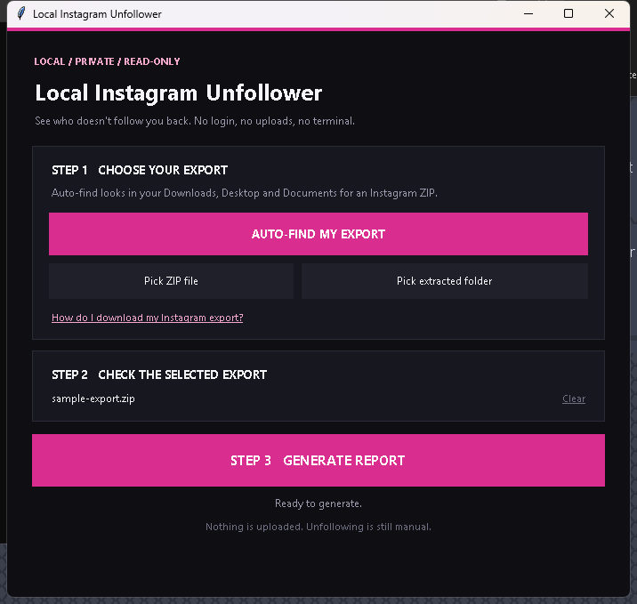
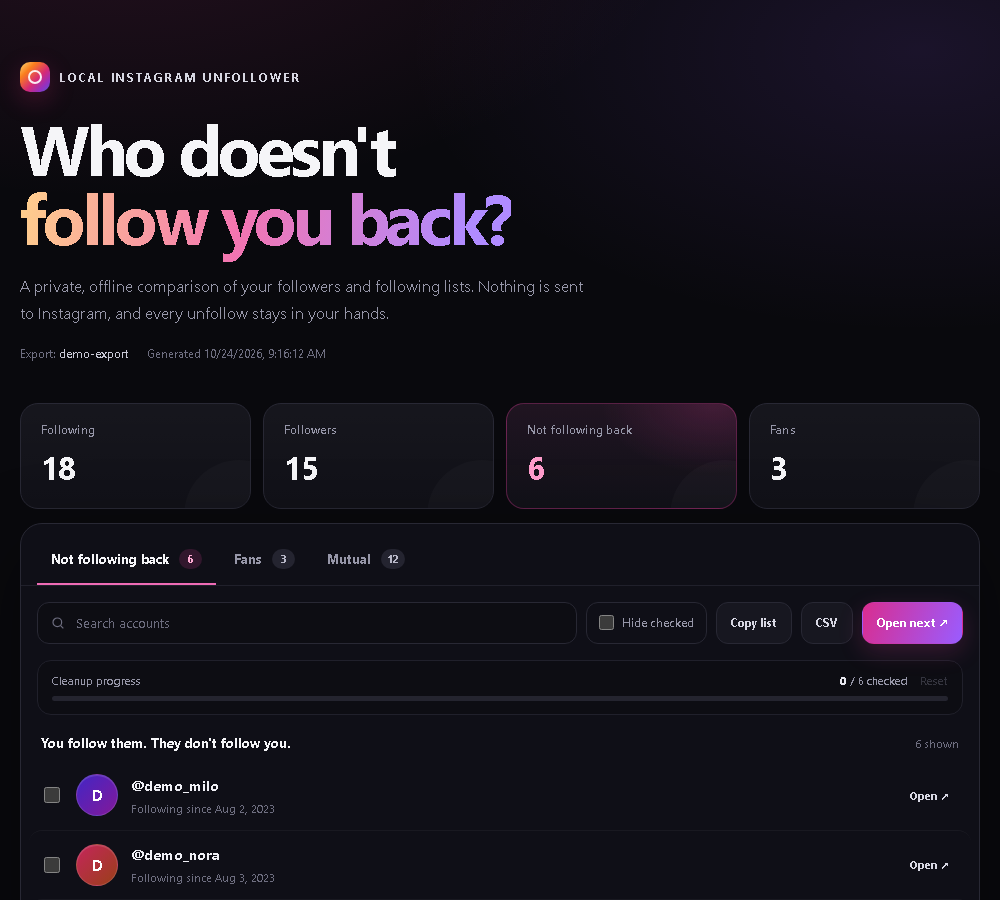

# Local Instagram Unfollower



A dead-simple, local app that shows who does **not** follow you back on Instagram. Free and open source (MIT).

It reads the official **JSON data export** from Instagram. It does not log in, scrape the website, unfollow anyone automatically, or upload your data anywhere.

## The easy way (Windows, no Python)

### 1. Get your Instagram export

1. Open **Instagram Accounts Center**.
2. Go to **Your information and permissions** -> **Download your information**.
3. Choose **Some of your information**.
4. Tick **Followers and following**.
5. Choose **JSON** as the format.
6. Download the ZIP when Instagram says it is ready.

### 2. Download the app

Open **[Releases](https://github.com/sinnerk/local-instagram-unfollower/releases/latest)** and download **`Local-Instagram-Unfollower.exe`**. Put it anywhere you like, for example your Desktop.

### 3. Run it

Double-click the EXE. No installation, no Python, no account access.

1. Click **AUTO-FIND MY EXPORT** (it checks Downloads, Desktop and Documents), or pick the ZIP yourself.
2. Click **STEP 3 GENERATE REPORT**.
3. The report opens in your browser.

> **Windows may show a SmartScreen warning** because the app is not code-signed. Click **More info -> Run anyway**. The full source is in this repository, so you can inspect or build it yourself.

You can also drag your export ZIP directly onto the EXE.

### Why does Windows warn about the EXE?

The EXE is **unsigned**. It has no Authenticode certificate, so Windows cannot verify a publisher. On first launch, SmartScreen may show **"Windows protected your PC"** or the file may say **Unknown publisher**. That is expected for an unsigned app; it is not a virus warning.

Code-signing certificates cost money and require identity verification, so small open-source projects usually ship unsigned builds. You do not have to trust the binary blindly:

- Every line of source is in this repository under the MIT license.
- You can run the Python source instead of the EXE.
- You can verify the download against the SHA-256 published in the [release notes](https://github.com/sinnerk/local-instagram-unfollower/releases/latest):

```powershell
Get-FileHash .\Local-Instagram-Unfollower.exe -Algorithm SHA256
```

To run the EXE anyway: click **More info -> Run anyway**.

## Run from source (Windows, macOS, Linux)

Prefer to run the Python source? Download the repo, then:

- **Windows:** double-click **`START_HERE.bat`**.
- **macOS / Linux:** run `python3 gui.py`.

> **Python 3.9 or newer is required**, with Tkinter. On Windows, install Python from [python.org](https://www.python.org/downloads/) and tick **"Add python.exe to PATH"**. On Debian/Ubuntu: `sudo apt install python3-tk`.

You can also drag your export ZIP directly onto `START_HERE.bat`.

## What it shows



- **Not following back** - accounts you follow that do not follow you.
- **Fans** - accounts that follow you that you do not follow back.
- **Mutual** - you follow each other.
- **Cleanup progress** - check off accounts as you unfollow them. Progress is saved in your browser.
- **Search, copy, CSV** - find accounts quickly and export the lists.

The report opens Instagram profile links in new tabs. You still click **Unfollow** yourself.

## Privacy

This project contains **no Instagram account data**:

- No export ZIPs, follower lists, usernames from a real account, credentials or local user paths are committed.
- All names in the tests and screenshots are made up.
- Generated reports stay in a local `report/` folder next to the app (or in `Documents\Local Instagram Unfollower`) and are excluded by `.gitignore`.
- The app has no analytics, no telemetry, and makes no network requests. The only network activity happens when **you** click a profile link or the Accounts Center help link.

The repository only contains the source code, fake test data and documentation.

## Where the files go

After generating a report, you will find a `report` folder next to the app:

```text
report/
  instagram_unfollowers.html
  instagram_unfollowers_not_following_back.txt
  instagram_unfollowers_accounts.csv
```

If that location is read-only, the app uses `Documents\Local Instagram Unfollower\report` instead. The success dialog shows the exact folder.

These files contain your private follower data. Keep them local and do not commit or upload them.

## CLI (optional)

If you prefer the command line:

```powershell
python ig_audit.py "C:\path\to\instagram-export.zip" --open
```

Useful options:

```text
--out PATH    Where to write the HTML report
--open        Open the report when finished
--version     Show the version
```

## Troubleshooting

**Windows says "Windows protected your PC"**  
The EXE is unsigned, so SmartScreen cannot verify a publisher. Click **More info -> Run anyway**, verify the SHA-256, or run the source with `START_HERE.bat`. See [Why does Windows warn about the EXE?](#why-does-windows-warn-about-the-exe).

**`START_HERE.bat` closes immediately**  
Python is probably not installed or is not on `PATH`. Install Python 3.9+ and tick **"Add python.exe to PATH"**. Or use the standalone EXE from Releases.

**Auto-find says no export was found**  
Click **Pick ZIP file** and choose the ZIP manually. Make sure it is the Instagram export, not the email attachment or an unrelated ZIP.

**The counts look wrong**  
Make sure you requested **Followers and following** in **JSON** format. Instagram may split large follower lists into `followers_1.json`, `followers_2.json`, and so on; keep the whole ZIP together so all chunks are read.

**"Could not find the following list"**  
The export was probably HTML instead of JSON. Request a new export and choose JSON.

**Instagram limits or warnings**  
This tool does not unfollow automatically. If you choose to unfollow manually, do it slowly. Rapid bulk actions can trigger Instagram restrictions.

## Development

Run the tests:

```bash
python -m unittest discover -s tests -v
```

The parser supports Instagram's current export format, split follower/following files, ZIP or extracted-folder input, URL-only records, and case-insensitive username matching.

### Build the standalone EXE

```powershell
uvx pyinstaller --noconfirm --clean --onefile --windowed `
  --name "Local-Instagram-Unfollower" `
  --icon "assets/icon.ico" `
  --add-data "assets/icon.ico;assets" `
  --version-file "packaging/version_info.txt" `
  gui.py
```

The result is `dist/Local-Instagram-Unfollower.exe`.

## Open source

This project is **MIT licensed**. Read the code, fork it, or build your own EXE. Issues and pull requests are welcome at [github.com/sinnerk/local-instagram-unfollower](https://github.com/sinnerk/local-instagram-unfollower).

## License

[MIT](LICENSE)
